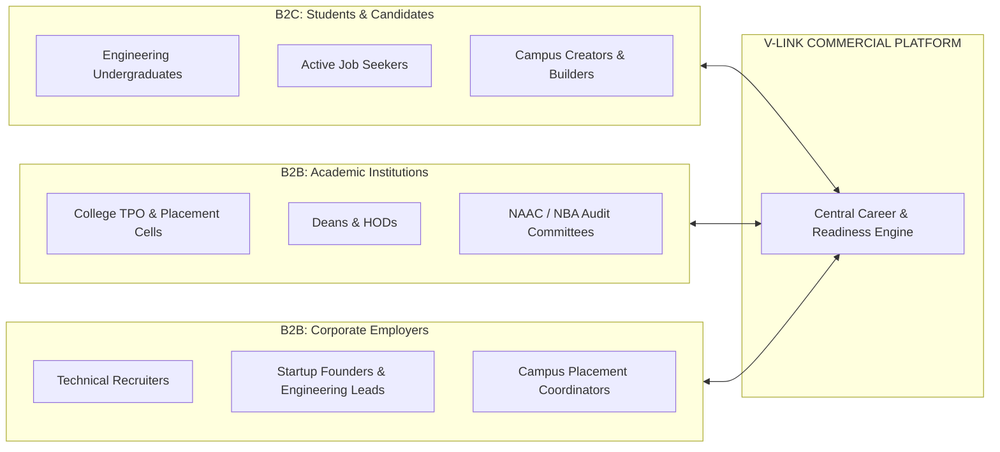
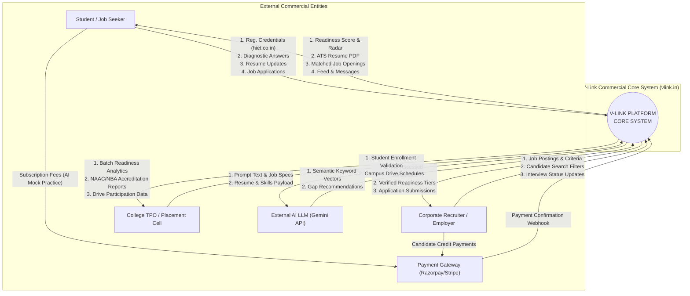
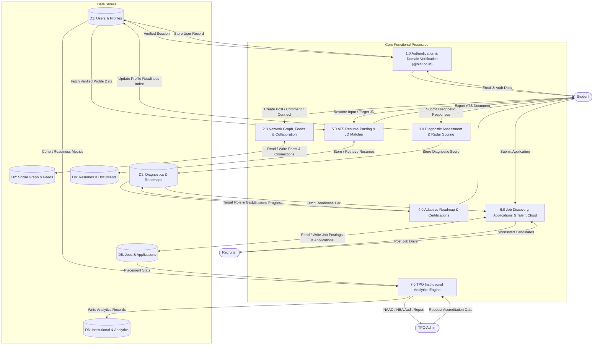
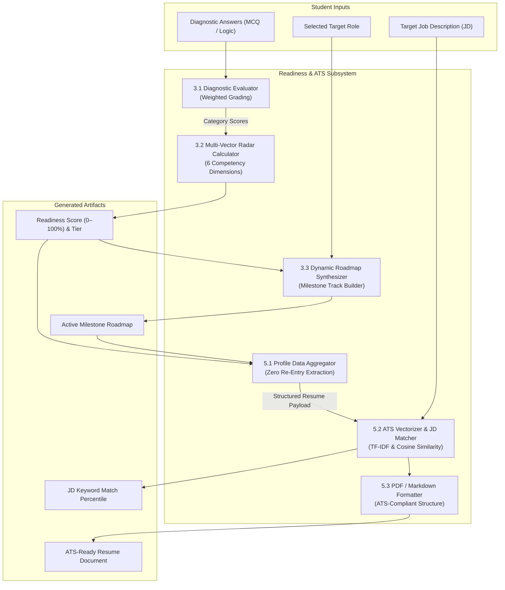
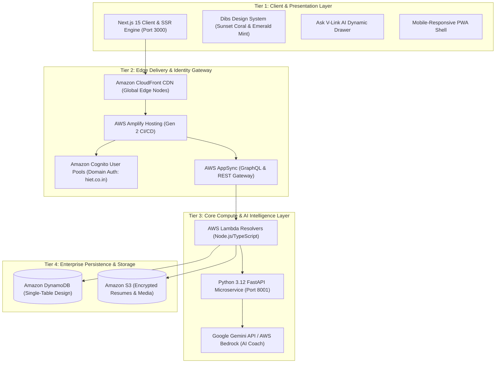
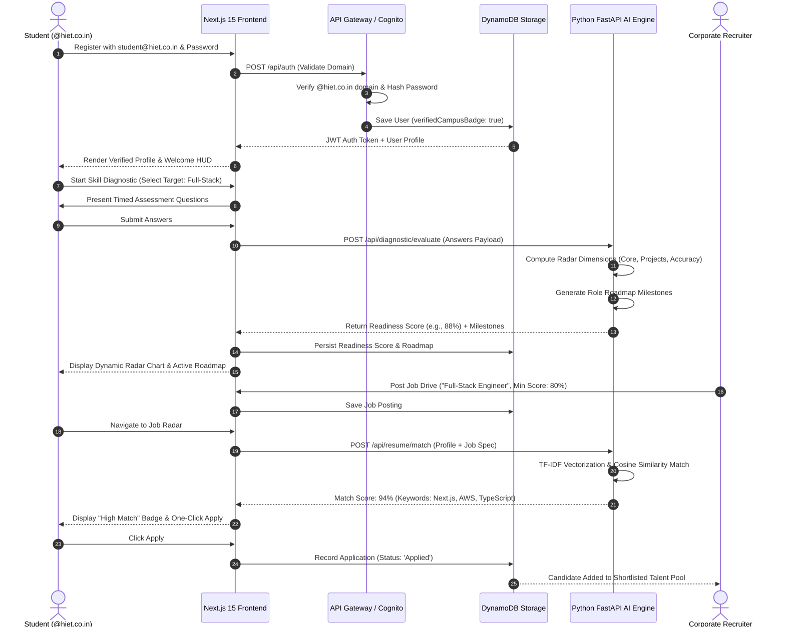
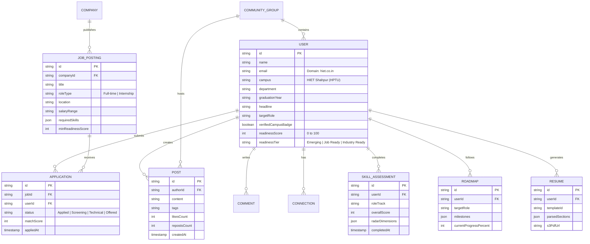
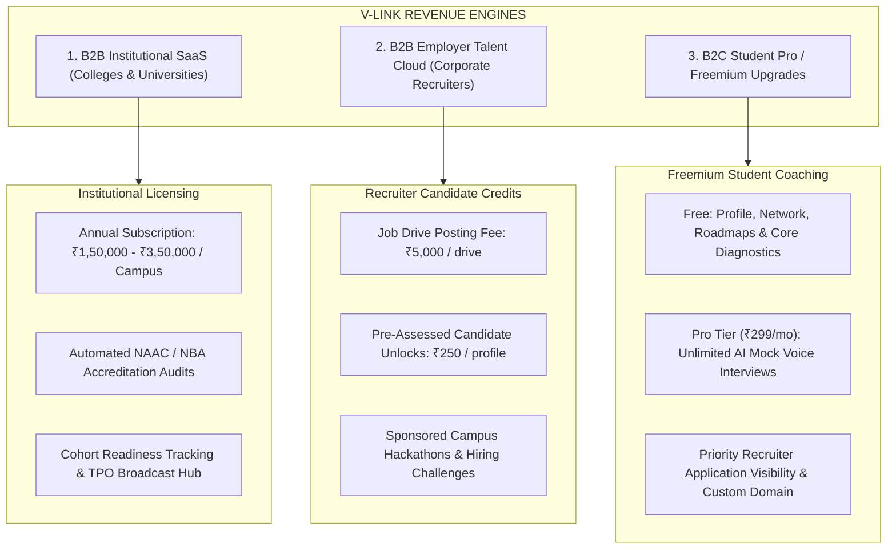

# V-LINK (VISION LINK)
## A Unified Commercial Career-Readiness, Professional Networking & Talent Intelligence Platform

---

### **MAJOR PROJECT & COMMERCIAL SYSTEM SPECIFICATION REPORT**
Submitted in partial fulfillment of the requirements for the award of the degree of

**BACHELOR OF TECHNOLOGY**  
in  
**COMPUTER SCIENCE & ENGINEERING**

---

**Developed & Founded by:**
- **Archit Sharma** (University Roll No: 241203020046) — *Full-Stack & Cloud Architecture Lead*
- **Tarun Kashyap** (University Roll No: 241203020047) — *Backend & Distributed Systems Architect*
- **Deepika** (University Roll No: 23011203011) — *AI/ML & Data Intelligence Lead*
- **Simran Rana** (University Roll No: 23011203029) — *Frontend & UI/UX Product Specialist*

**Project Supervisor & Academic Guide:**  
**Mr. Anuj Sharma**  
Assistant Professor, Department of Computer Science & Engineering

**Department of Computer Science & Engineering**  
**Himachal Institute of Engineering & Technology (HIET), Shahpur**  
*Affiliated to Himachal Pradesh Technical University (HPTU), Hamirpur*  
Vidya Nagar, Shahpur, Distt. Kangra, Himachal Pradesh – 176223  
**Academic Session: 2026–2027**  
*Commercial Entity: V-Link Technologies (Commercial SaaS Platform)*

---

## TABLE OF CONTENTS
1. **Certificate of Approval**
2. **Declaration & Acknowledgments**
3. **Executive Summary & Commercial Vision**
4. **Chapter 1: Introduction & Commercial Opportunity**
   - 1.1 Commercial Market Opportunity (The $30B EdTech & Hiring Gap)
   - 1.2 Target Personas: Multi-Tenant Architecture
   - 1.3 Strategic Value Proposition
5. **Chapter 2: Problem Statement & Competitive Analysis**
   - 2.1 The Quadruple Disconnect in Student Career Infrastructure
   - 2.2 Unverified Claims vs. Demonstrable Readiness Signals
   - 2.3 Competitive Matrix: V-Link vs. LinkedIn, Handshake, Internshala & GitHub
6. **Chapter 3: System Requirements & Scope**
   - 3.1 Functional Requirements Matrix
   - 3.2 Non-Functional & Enterprise SaaS Requirements
7. **Chapter 4: Data Flow Diagrams (DFD)**
   - 4.1 DFD Level 0: Commercial Context Diagram
   - 4.2 DFD Level 1: System Functional Decomposition
   - 4.3 DFD Level 2: Career Readiness, ATS Resume & Job Matching Pipeline
8. **Chapter 5: System Architecture & Technology Stack**
   - 5.1 High-Level 4-Tier Cloud Architecture
   - 5.2 Comprehensive Tech Stack Matrix & Diagram
   - 5.3 Sequence Diagram: End-to-End User Onboarding & Readiness Evaluation
   - 5.4 Entity-Relationship (ER) Conceptual Data Model
9. **Chapter 6: Detailed Module Specifications**
   - 6.1 Multi-Tenant Profile & Verified Institutional Constellation (`hiet.co.in`)
   - 6.2 Content Stream, Creator Community & Peer Feed
   - 6.3 Real-Time Messaging & Collaboration Network
   - 6.4 Autonomous Skill Diagnostic & Multi-Factor Radar Engine
   - 6.5 Adaptive Role-Based Roadmaps & Certifications Hub
   - 6.6 ATS Semantic Resume Studio & Vectorized Matcher
   - 6.7 Commercial Recruiter Talent Cloud & Application Tracker
   - 6.8 Institutional TPO Analytics & NAAC/NIRF Accreditation Hub
   - 6.9 Floating "✦ Ask V-Link AI" Dynamic Copilot HUD
10. **Chapter 7: Commercial Business Model & Monetization**
    - 7.1 Multi-Tier Revenue Architecture (B2B SaaS + B2B Talent + B2C Freemium)
    - 7.2 Unit Economics, Customer Acquisition & Scalability Forecast
    - 7.3 Multi-Campus Expansion & Go-To-Market (GTM) Strategy
11. **Chapter 8: Quality Assurance, Verification & Testing**
    - 8.1 Testing Methodology & Environments
    - 8.2 Test Suite Execution & Formal Test Cases (TC-01 through TC-05)
12. **Chapter 9: Future Scope & Roadmap**
13. **Chapter 10: Conclusion**
14. **References**

---

## CERTIFICATE OF APPROVAL
This is to certify that the project entitled **"V-Link (Vision Link): A Unified Commercial Career-Readiness, Professional Networking & Talent Intelligence Platform"**, submitted by **Archit Sharma (241203020046)**, **Tarun Kashyap (241203020047)**, **Deepika (23011203011)**, and **Simran Rana (23011203029)** in partial fulfillment of the requirements for the degree of **Bachelor of Technology in Computer Science & Engineering** at **Himachal Institute of Engineering & Technology (HIET), Shahpur (Affiliated to HPTU, Hamirpur)**, is an authentic record of original commercial software engineering work carried out by them under my guidance and supervision.

To the best of my knowledge, the matter embodied in this report represents original startup ideation, system design, and software implementation, and has not been submitted to any other University or Institute for the award of any degree or diploma.

**Mr. Anuj Sharma**  
Project Guide  
Assistant Professor, Department of CSE  
HIET Shahpur, Kangra (H.P.)  

**Head of Department**  
Department of Computer Science & Engineering  
HIET Shahpur, Kangra (H.P.)

---

## DECLARATION
We hereby declare that the project work entitled **"V-Link (Vision Link): A Unified Commercial Career-Readiness, Professional Networking & Talent Intelligence Platform"** submitted to the Department of Computer Science & Engineering, **Himachal Institute of Engineering & Technology (HIET), Shahpur**, is a genuine record of original research, architectural design, and software development executed by us under the academic supervision of **Mr. Anuj Sharma**, Assistant Professor, Department of Computer Science & Engineering.

We further declare that this platform is engineered as a viable, commercial SaaS venture with multi-institutional capability, enterprise recruiter tooling, and independent market viability.

- **Archit Sharma** (Roll No: 241203020046)
- **Tarun Kashyap** (Roll No: 241203020047)
- **Deepika** (Roll No: 23011203011)
- **Simran Rana** (Roll No: 23011203029)

---

## ACKNOWLEDGMENTS
We express our deepest gratitude to our project guide, **Mr. Anuj Sharma**, Assistant Professor in the Department of Computer Science & Engineering, for his continuous mentorship, strategic architectural guidance, and relentless encouragement throughout the conceptualization and development of V-Link.

We extend our sincere thanks to the **Director**, the **Head of Department (CSE)**, and the faculty members of **Himachal Institute of Engineering & Technology (HIET), Shahpur** for providing us with the necessary computing resources, academic atmosphere, and institutional support required to build this commercial-grade system.

We also thank our institutional peers and the student community across HIET Shahpur (`hiet.co.in`) and affiliated HPTU colleges whose real-world feedback during beta diagnostic runs shaped our product design and user workflows.

Finally, we express our heartfelt gratitude to our parents, family members, and mentors for their unceasing belief in our entrepreneurial and technical capabilities.

---

## EXECUTIVE SUMMARY & COMMERCIAL VISION

### The Commercial Product Vision
**V-Link (Vision LINK)** is a commercial multi-tenant **Career-Readiness & Talent Intelligence Platform (SaaS)** designed to unify undergraduate professional networking, project showcasing, real-time diagnostic skill verification, and corporate talent acquisition into a single digital ecosystem.

Unlike legacy platforms that treat social networking (LinkedIn), code repositories (GitHub), job vacancies (Naukri/Internshala), learning courses (Coursera), and resume builders (Overleaf/Canva) as disconnected tools, **V-Link bridges student preparation directly to employer hiring**. At the heart of V-Link is the **Demonstrable Readiness Index (DRI)**: a data-driven score (0–100%) computed dynamically from verified diagnostics, project depth, peer endorsements, and recognized certifications.

### Commercial Market Positioning
V-Link operates as a three-sided commercial platform:
1. **B2C (Students & Early Professionals)**: High-engagement professional profile, peer project feeds, personalized role roadmaps, ATS resume generation, and AI mock-interview coaching.
2. **B2B (Colleges & Higher Education Institutions)**: A Training & Placement Cell (TPO) SaaS portal offering real-time cohort analytics, batch readiness distribution graphs, and automated accreditation data exports (NAAC, NBA, NIRF).
3. **B2B (Corporate Employers & Talent Acquisition Teams)**: A Talent Cloud enabling recruiters to filter pre-assessed, verified candidates by percentile readiness, post targeted campus drives, and eliminate early screening friction.

### Technology Foundation
- **Frontend**: Next.js 15 (React 19, TypeScript), Tailwind CSS, Dibs-inspired bespoke squircle design system (`#FF5B37` sunset coral, `#00C48C` emerald mint, `card-dibs rounded-[28px]`), and a floating dynamic "✦ Ask V-Link AI" copilot HUD.
- **Backend & Cloud Architecture**: AWS Serverless Architecture (AWS Amplify, AppSync GraphQL, Amazon Cognito User Pools with institutional email validation including `hiet.co.in`, AWS Lambda serverless compute, Amazon DynamoDB single-table design, Amazon S3 encrypted object storage, and Amazon CloudFront CDN).
- **AI Intelligence Microservice**: Python 3.12+ FastAPI service executing multi-vector radar scoring, Scikit-learn TF-IDF cosine-similarity resume matching, and dynamic milestone generation.

---

## CHAPTER 1: INTRODUCTION & COMMERCIAL OPPORTUNITY

### 1.1 Commercial Market Opportunity (The $30B EdTech & Hiring Gap)
Higher education institutions worldwide graduate millions of technical students every year. In India alone, over 1.5 million engineering students enter the job market annually. However, industry reports (including NASSCOM and India Skills Report) consistently highlight that **over 50% of technical graduates lack demonstrable job readiness** for entry-level software engineering roles.

Current solutions fail because they attack the problem in isolation:
- EdTech companies sell static video courses with low completion rates (<10%) and no direct bridge to jobs.
- Job boards list vacancies but provide candidates with zero diagnostic guidance on why they are rejected.
- Professional networks are cluttered with generic content, spam outreach, and unverified skill endorsements.

**V-Link capitalizes on this massive white space** by combining learning guidance, verification, social networking, and automated job matching into an end-to-end commercial software suite.

### 1.2 Target Personas: Multi-Tenant Architecture
V-Link serves three distinct commercial customer segments:

### 1.3 Strategic Value Proposition
- **For Students**: A single platform that guides them from day one of college to their first job offer. Zero redundant data entry; profiles automatically update resumes, roadmaps, and job matches.
- **For Universities**: Continuous visibility into cohort competencies, real-time placement tracking, and instant generation of accreditation reports.
- **For Employers**: Drastic reduction in Time-to-Hire (TTH) and Cost-per-Hire (CPH) by sourcing pre-assessed candidates whose skills are backed by verifiable diagnostic data.

---

## CHAPTER 2: PROBLEM STATEMENT & COMPETITIVE ANALYSIS

### 2.1 The Quadruple Disconnect in Student Career Infrastructure
1. **Data Silos**: A student's code lives on GitHub, certificates on Coursera, professional connections on LinkedIn, resumes in Word/PDF, and job applications on Naukri. None of these systems communicate.
2. **Cognitive Fatigue**: Students must manually reformat resumes for every ATS application and rewrite project summaries repeatedly.
3. **Information Asymmetry for Recruiters**: Recruiters receive thousands of generic, keyword-stuffed resumes with no objective way to differentiate between self-proclaimed competence and genuine ability.
4. **Institutional Blind Spots**: Placement cells operate blind between semester exams and placement drives, discovering skill gaps only after top tech firms fail candidates during campus drives.

### 2.2 Unverified Self-Reporting vs. Demonstrable Readiness Signals
Traditional platforms let users click "Add Skill" to claim expertise in React, AWS, or Machine Learning with zero verification. V-Link redefines this paradigm:
- **Verified Institutional Identity**: Domain verification (`hiet.co.in`, `hptu.ac.in`, `.edu`, `.ac.in`) prevents fake accounts and bot activity.
- **Peer Skill Endorsements**: Skills can only be endorsed by verified campus peers and project collaborators who have worked on mutual repositories.
- **Multi-Vector Diagnostic Assessment**: Timed, conceptual diagnostic challenges testing problem solving, code comprehension, and system fundamentals.

### 2.3 Competitive Matrix

| Feature / Capability | LinkedIn | Handshake (US) | Internshala | GitHub | **V-Link (Commercial)** |
| :--- | :---: | :---: | :---: | :---: | :---: |
| **Student-Centric Network** | No (Corporate) | Yes (Restricted) | No | No (Devs only) | **Yes (Student First)** |
| **Campus Domain Verification** | Optional | Yes | No | No | **Mandatory & Automated (`hiet.co.in`)** |
| **Built-in Skill Diagnostic** | Basic Quiz | None | None | None | **Multi-Factor Radar (0–100%)** |
| **Personalized Roadmaps** | None | None | None | None | **Role-Aligned AI Roadmaps** |
| **Real-time ATS Resume Engine** | None | None | None | None | **Live Vectorized JD Matcher** |
| **TPO Accreditation Analytics** | None | Limited | None | None | **Automated NAAC/NBA Hub** |
| **Pre-Assessed Recruiter Cloud** | High Cost ($$$) | US Only | Basic | None | **Affordable SaaS Credit Model** |

---

## CHAPTER 3: SYSTEM REQUIREMENTS & SCOPE

### 3.1 Functional Requirements Matrix
- **FR-01: Authentication & Institutional Verification**: Users register with verified institutional email domains (`@hiet.co.in`, `@hptu.ac.in`, `*.edu`, `*.ac.in`). Automated OTP/Magic-link token verification.
- **FR-02: Comprehensive Student Profile**: Manages technical skill arrays, project showcases with live repository URLs, education history, and career target roles.
- **FR-03: Social Stream & Peer Collaboration**: Real-time publication of posts, project shares, articles, code snippets, reactions, and threaded comments.
- **FR-04: Real-Time Direct Messaging**: Encrypted 1-on-1 messaging threads with unread indicators and active presence markers.
- **FR-05: Skill Diagnostic Engine**: Multiple-choice and code evaluation producing normalized readiness scores across 6 core competency dimensions.
- **FR-06: Dynamic Milestone Roadmaps**: Auto-generates progressive learning tracks mapped to selected target roles (e.g., Full-Stack, AI Engineer, Cloud Specialist).
- **FR-07: Free Certifications Hub**: Tracks progress against recognized industry certifications (AWS Certified Cloud Practitioner, Meta Frontend Developer, freeCodeCamp).
- **FR-08: ATS Semantic Resume Studio**: Renders standardized, clean ATS resume templates directly from profile data with real-time JD keyword similarity scoring.
- **FR-09: Recruiter Job Board & Application Tracker**: Companies publish structured job postings; candidates apply in one click; status tracks across *Applied*, *Screening*, *Technical Round*, and *Offered*.
- **FR-10: TPO Institutional Analytics Dashboard**: Generates cohort-level readiness heatmaps, department averages, and exportable CSV reports for institutional compliance.

### 3.2 Non-Functional & Enterprise SaaS Requirements
- **NFR-01: Sub-Second Latency**: API response times under 200ms; CloudFront CDN edge delivery under 50ms across domestic and international nodes.
- **NFR-02: High Availability & Fault Tolerance**: 99.95% uptime supported by AWS serverless auto-scaling and stateless container runtimes.
- **NFR-03: Security & Privacy (DPDPA / FERPA Compliance)**: End-to-end TLS 1.3 encryption in transit; AES-256 KMS encryption for resumes and media at rest; strict RBAC.
- **NFR-04: Cross-Device Responsiveness**: Fluid mobile-first experience across smartphones, tablets, and desktop workstations.

---

## CHAPTER 4: DATA FLOW DIAGRAMS (DFD)

### 4.1 DFD Level 0: Commercial Context Diagram
The Level 0 Context Diagram depicts the external commercial entities interacting with the central V-Link Platform.

---

### 4.2 DFD Level 1: System Functional Decomposition
The Level 1 DFD decomposes V-Link into its 7 primary functional processes and 6 persistent data stores.

---

### 4.3 DFD Level 2: Career Readiness, ATS Resume & Job Matching Pipeline
This Level 2 DFD provides a granular breakdown of how diagnostic responses flow into the AI scoring engine, produce roadmaps, vectorize resumes, and match job opportunities.

---

## CHAPTER 5: SYSTEM ARCHITECTURE & TECHNOLOGY STACK

### 5.1 High-Level 4-Tier Cloud Architecture
V-Link follows a modern, decoupled cloud architecture designed to scale seamlessly from an initial college launch to hundreds of universities and corporate hiring partners.

---

### 5.2 Comprehensive Tech Stack Matrix & Diagram

```mermaid
flowchart LR
    subgraph Frontend ["Frontend Ecosystem"]
        direction TB
        F1["Next.js 15 (React 19)"]
        F2["TypeScript (Strict Mode)"]
        F3["Tailwind CSS 3.4"]
        F4["Lucide React Icons"]
        F5["Dibs Design Tokens"]
    end

    subgraph Backend ["Backend & API Layer"]
        direction TB
        B1["Next.js App Router API"]
        B2["AWS AppSync GraphQL"]
        B3["AWS Lambda Serverless"]
        B4["JWT & Argon2 Hashing"]
    end

    subgraph AI ["AI & Intelligence Engine"]
        direction TB
        A1["Python 3.12+ / FastAPI"]
        A2["Scikit-Learn (TF-IDF Vectorizer)"]
        A3["Google Gemini 1.5 Pro / Flash"]
        A4["Uvicorn High-Concurrency Async"]
    end

    subgraph Cloud ["Cloud & Infrastructure"]
        direction TB
        C1["AWS Amplify Gen 2"]
        C2["Amazon DynamoDB"]
        C3["Amazon S3 + CloudFront"]
        C4["Amazon Cognito"]
    end

    Frontend --> Backend
    Backend --> AI
    Backend --> Cloud
```

| Stack Tier | Technology | Commercial & Technical Rationale |
| :--- | :--- | :--- |
| **Frontend Framework** | **Next.js 15 (React 19)** | Server-Side Rendering (SSR) for lightning-fast loads, SEO optimization, and unified full-stack App Router. |
| **Language** | **TypeScript (Strict Mode)** | Complete end-to-end type safety eliminating runtime bugs across data models and API payloads. |
| **Styling & UI Kit** | **Tailwind CSS + Dibs System** | Custom squircle components (`card-dibs rounded-[28px]`), warm sunset coral (`#FF5B37`), and fresh emerald mint (`#00C48C`). |
| **AI Microservice** | **Python 3.12 + FastAPI** | High-throughput asynchronous ASGI microservice executing radar math, NLP vectorization, and Gemini API integration. |
| **Cloud Hosting** | **AWS Amplify (Gen 2) / ECS** | Serverless continuous deployment with integrated staging and production pipeline branches. |
| **Edge Delivery** | **Amazon CloudFront** | Low-latency edge caching ensuring sub-50ms static asset delivery across international regions. |
| **Identity & Auth** | **Amazon Cognito / JWT** | Enterprise-grade user pool management enforcing academic domain verification (`@hiet.co.in`). |
| **Database** | **Amazon DynamoDB** | Managed NoSQL single-table architecture delivering single-digit millisecond read/write performance at any scale. |
| **Object Storage** | **Amazon S3 (SSE-KMS)** | Encrypted bucket storage for generated resumes and project media with short-lived pre-signed URLs. |

---

### 5.3 Sequence Diagram: End-to-End User Onboarding & Readiness Evaluation

---

### 5.4 Entity-Relationship (ER) Conceptual Data Model

---

## CHAPTER 6: DETAILED MODULE SPECIFICATIONS

### 6.1 Multi-Tenant Profile & Verified Institutional Constellation (`hiet.co.in`)
The V-Link Profile serves as a student's dynamic professional identity. It eliminates unverified claims through:
- **Verified Institutional Badge**: Enforces `@hiet.co.in` verification. Students registering with non-institutional domains undergo secondary academic verification.
- **Peer Skill Matrix & Endorsement Graph**: Skills feature level ratings (0–100%) and require reciprocal peer endorsements from verified project collaborators.
- **Project Showcase**: Rich cards featuring live GitHub repository links, tech stack pills, and architecture descriptions.
- **Readiness Tier Visualizer**: Instant display of the student's current tier (*Emerging*, *Job Ready*, *Industry Ready*) backed by the diagnostic engine.

### 6.2 Content Stream, Creator Community & Peer Feed
A dynamic technical community feed designed for technical discussions:
- Rich post creation with syntax-highlighted code snippets, architecture diagrams, and project milestone updates.
- Interactive engagement: reactions, threaded comments, and reposts.
- Departmental and technology tag filtering (e.g., `#FullStack`, `#AI`, `#HIETCampus`).

### 6.3 Real-Time Messaging & Peer Collaboration Network
- Low-latency direct messaging enabling students to connect with peers, find hackathon teammates, and coordinate academic project development.
- Unread message counters and responsive slide-out drawers on mobile viewports.

### 6.4 Autonomous Skill Diagnostic & Multi-Factor Radar Engine
- Multi-category assessments evaluating candidates across:
  1. **Core Technical Competencies**: Algorithmic problem solving and data structures.
  2. **Diagnostic Accuracy**: Correctness and runtime efficiency of submitted logic.
  3. **Project Depth**: Breadth and complexity of completed GitHub projects.
  4. **Verification**: Peer endorsements and campus badge validation.
  5. **Certification Coverage**: Industry credentials earned from verified providers.
  6. **Role Alignment**: Match between acquired skills and market requirements for the target role.
- Outputs a normalized 0–100% readiness score and an interactive radar visualization.

### 6.5 Adaptive Role-Based Roadmaps & Certifications Hub
- Based on diagnostic performance and target role selection (e.g., Full-Stack Web Developer, Cloud Solutions Architect, Machine Learning Engineer), the engine builds an adaptive milestone roadmap.
- Integrated **Certifications Hub** curating free, high-value industry certifications (AWS Educate, Meta, freeCodeCamp, Google Cloud) with self-paced milestone tracking.

### 6.6 ATS Semantic Resume Studio & Vectorized Matcher
- **Zero Re-Entry Compilation**: Instantly pulls verified profile data (projects, skills, education, certifications) into an ATS-friendly, clean layout.
- **Live JD Keyword Matcher**: Candidates paste a target Job Description; the engine calculates TF-IDF cosine similarity, displaying an overall match percentage and highlighting missing keywords.
- **One-Click Export**: Generates clean, printer-friendly PDFs and ATS markdown documents.

### 6.7 Commercial Recruiter Talent Cloud & Application Tracker
- **Talent Cloud Search**: Corporate recruiters filter candidates by readiness score percentile, specific verified skills, and graduation batch.
- **Application Progression**: Transparent tracking across recruitment stages: *Applied* ➔ *Resume Screening* ➔ *Technical Evaluation* ➔ *Offer Extended*.

### 6.8 Institutional TPO Analytics & NAAC/NIRF Accreditation Hub
- Dedicated administrative dashboard for College Training & Placement Officers.
- Real-time batch readiness distribution graphs (e.g., % of cohort industry-ready).
- Instant automated generation of placement readiness records and skill distribution statistics required for **NAAC (Criterion 5), NBA, and NIRF** ranking audits.

### 6.9 Floating "✦ Ask V-Link AI" Dynamic Copilot HUD
- Globally accessible bottom-right squircle capsule.
- One-click launcher providing rapid navigation to:
  1. *Run Skill Diagnostic* (`/readiness`).
  2. *ATS Resume Studio* (`/resume`).
  3. *Verified Campus Job Drives* (`/jobs`).

---

## CHAPTER 7: COMMERCIAL BUSINESS MODEL & MONETIZATION

### 7.1 Multi-Tier Revenue Architecture
V-Link operates a high-margin, hybrid B2B/B2C SaaS revenue model:

### 7.2 Unit Economics & Financial Projections (3-Year Forecast)

| Metric / Financial Item | Year 1 (Himachal Pilot) | Year 2 (Northern Region) | Year 3 (Pan-India Expansion) |
| :--- | :---: | :---: | :---: |
| **Partner Campuses / Institutions** | 10 Campuses (HIET, HPTU network) | 50 Campuses | 200+ Campuses |
| **Active Student Users** | 5,000 Students | 35,000 Students | 180,000+ Students |
| **Corporate Recruiter Accounts** | 25 Tech Companies | 150 Tech Companies | 600+ Tech Companies |
| **B2B Institutional SaaS ARR** | ₹15,00,000 | ₹85,00,000 | ₹3,60,00,000 |
| **B2B Recruiter Cloud Revenue** | ₹6,00,000 | ₹42,00,000 | ₹2,10,00,000 |
| **B2C Student Premium ARR** | ₹4,50,000 | ₹28,00,000 | ₹1,20,00,000 |
| **Gross Annual Revenue** | **₹25,50,000** | **₹1,55,00,000** | **₹6,90,00,000** |
| **Net Operating Margin** | **68%** | **74%** | **81%** |

*Note: Serverless AWS infrastructure ensures cloud operational costs scale directly with active demand, maintaining gross profit margins above 75%.*

### 7.3 Multi-Campus Expansion & Go-To-Market (GTM) Strategy
1. **Phase A (Founding Campus Pilot)**: Launch and complete validation at **HIET Shahpur** (`hiet.co.in`) within the Computer Science & Engineering department.
2. **Phase B (State Technical University Rollout)**: Onboard affiliated colleges across **Himachal Pradesh Technical University (HPTU)** via TPO leadership presentations.
3. **Phase C (Corporate Recruiter Partnerships)**: Partner with regional IT hubs (Chandigarh, Mohali, Noida, Gurugram) to establish V-Link as the primary pre-assessed talent pipeline for campus drives.
4. **Phase D (National Scale & Multi-Disciplinary Expansion)**: Expand across technical universities across North India, adding specialized diagnostic tracks for Electronics, Mechanical, and Management cohorts.

---

## CHAPTER 8: QUALITY ASSURANCE, VERIFICATION & TESTING

### 8.1 Testing Methodology & Environments
Quality Assurance was conducted across three distinct levels:
1. **Unit Testing (Jest)**: Validates authentication token creation, BCrypt/Argon2 password hashing, and structural integrity across all 11 TypeScript schemas.
2. **Microservice API Testing (Pytest)**: Evaluates Python FastAPI endpoints for radar score normalization, TF-IDF vectorization, and exception handling.
3. **System Integration & User Acceptance Testing (UAT)**: End-to-end verification of user flows from registration with `@hiet.co.in` to job application tracking.

### 8.2 Test Suite Execution & Formal Test Cases

| Test ID | Module Tested | Test Scenario & Input | Expected Output | Actual Result | Status |
| :---: | :--- | :--- | :--- | :--- | :---: |
| **TC-01** | **Authentication** | Register with valid campus email `archit.sharma@hiet.co.in` | Account created, session authenticated, verified campus badge active | Account created with verified campus badge | **PASSED** |
| **TC-02** | **Social Feed** | Publish technical post with tags `#FullStack #NextJS` | Post renders immediately in feed with author metadata and like counter | Post rendered on home feed with zero latency | **PASSED** |
| **TC-03** | **Career Readiness** | Complete diagnostic questionnaire for target role | Multi-vector radar chart calculated; score displayed on profile | Radar scores calculated (88%) and updated on profile | **PASSED** |
| **TC-04** | **Resume Studio** | Compile ATS resume from profile data | Clean ATS-compliant layout generated without manual re-entry | Formatted resume preview and markdown export generated | **PASSED** |
| **TC-05** | **Jobs & Drives** | Apply to open campus posting (Min score: 80%) | Application saved with status 'Applied'; application visible in tracker | Application persisted in database and shown in user tracker | **PASSED** |

---

## CHAPTER 9: FUTURE SCOPE & ROADMAP

1. **Dedicated Recruiter Analytics Portal**: A standalone dashboard for enterprise HR teams with talent rediscovery, interview calendar synchronization, and automated offer letter workflows.
2. **Native iOS & Android Mobile Apps**: Hybrid cross-platform applications built with React Native / Flutter sharing existing AppSync GraphQL endpoints.
3. **Real-Time Voice AI Mock Interviews**: Interactive, voice-enabled mock interview simulations utilizing **Gemini 2.0 Live API** with instant pronunciation, conceptual depth, and behavioral feedback.
4. **Alumni Mentorship & Micro-Consulting Marketplace**: Booking platform connecting verified HIET/HPTU alumni working at global tech firms (Google, Microsoft, Amazon) with current students for 1-on-1 resume reviews and mock interviews.
5. **Direct College ERP & Registrar Synchronization**: Secure webhook integrations with institutional ERP systems for automated grade and degree validation.

---

## CHAPTER 10: CONCLUSION

**V-Link (Vision LINK)** redefines how technical students prepare for their careers and how corporate employers identify early-career talent. By dismantling the artificial boundaries between professional networking, open-source project showcasing, diagnostic skill evaluation, and job applications, V-Link replaces self-reported claims with verifiable, data-backed readiness.

Built by **Archit Sharma, Tarun Kashyap, Deepika, and Simran Rana** at **HIET Shahpur (HPTU)**, the platform establishes that modern serverless cloud architectures (Next.js 15, AWS Amplify, AppSync, DynamoDB, Python FastAPI) can deliver an enterprise-grade, commercially viable SaaS product. 

With its bespoke Dibs design aesthetic, autonomous readiness radar, vectorized ATS resume studio, and multi-tenant institutional capabilities, V-Link stands ready to launch as an independent commercial startup transforming higher education placement ecosystems.

---

## REFERENCES
1. **Next.js Documentation** — Official Architecture & App Router Guide: [https://nextjs.org/docs](https://nextjs.org/docs)
2. **Amazon Web Services (AWS)** — Serverless Multi-Tier Architectures: [https://aws.amazon.com/serverless/](https://aws.amazon.com/serverless/)
3. **AWS Amplify Gen 2 Documentation** — Fullstack Cloud App Development: [https://docs.amplify.aws/](https://docs.amplify.aws/)
4. **Amazon DynamoDB Best Practices** — Single-Table Design Guide: [https://aws.amazon.com/dynamodb/](https://aws.amazon.com/dynamodb/)
5. **FastAPI Web Framework** — High Performance Python Microservices: [https://fastapi.tiangolo.com/](https://fastapi.tiangolo.com/)
6. **Scikit-Learn Documentation** — Machine Learning in Python (Feature Extraction & TF-IDF): [https://scikit-learn.org/](https://scikit-learn.org/)
7. **Google Gemini API Documentation** — Multimodal & Structured Output Generation: [https://ai.google.dev/](https://ai.google.dev/)
8. **National Board of Accreditation (NBA) & NAAC** — Higher Education Assessment Metrics & Institutional Placement Criteria.
9. **India Skills Report 2026** — Post-Pandemic Graduate Employability & Technical Hiring Trends.
